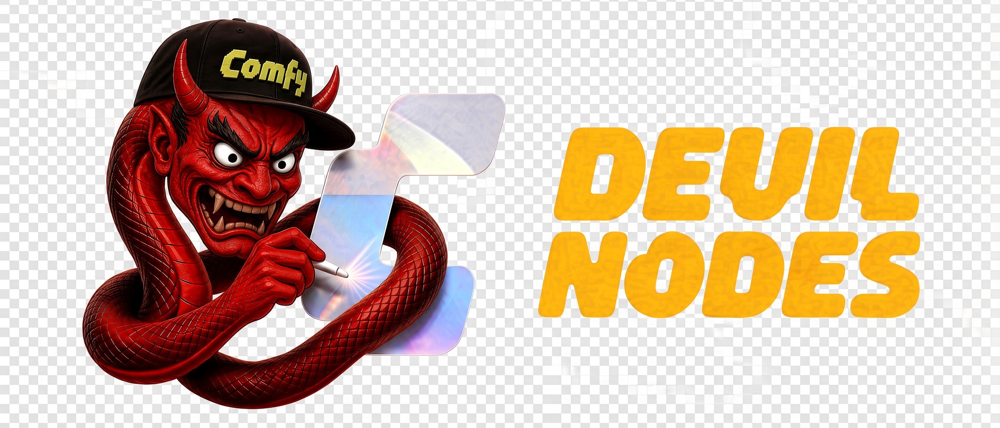

# Devil H3 Nodes

ComfyUI nodes by [ComfyUIdev](https://github.com/ComfyUIdev).

**Devil H3 Character Sheet** lays out a still character sheet for native MiniMax H3 image references. One character photo and up to three optional part photos pass through unchanged. You pick the views, optional notes, and reference roles. The node writes the prompt, the width, and the height, and it draws a placement guide.

Inspired by [H3 Character Sheet Designer](https://github.com/ukr8b3g-cmyk/H3-Character-Sheet-Designer) by ukr8b3g-cmyk.



## Install

Install **Devil H3 Nodes** (`devil-h3-nodes`) and restart ComfyUI. The folder ComfyUI loads is `devil-h3-nodes`. No extra Python packages are required.

### ComfyUI-Manager

Open Manager, search for **Devil H3 Nodes**, and install it from the Registry.

### Registry CLI

```bash
comfy node install devil-h3-nodes
```

### Git

```bash
cd ComfyUI/custom_nodes
git clone https://github.com/ComfyUIdev/devil-h3-nodes
```

## Start

1. Open [workflows/devil_h3_character_sheet.json](workflows/devil_h3_character_sheet.json).
2. Pick an H3 diffusion model, an H3 text encoder, and the H3 video VAE. Set the CLIP loader type to **minimax**. A Music3 encoder is the wrong model and will not match this graph.
3. Load a character image. The three extra Load Image nodes are bypassed until you need them. Turn one on, or disconnect it.
4. Choose a preset or toggle views. Auto keeps the full-body panel height and may widen the canvas. Manual keeps the width and height you type.
5. Leave **Pass layout image** off at first. The widget still shows the guide. Turn it on when you want that guide sent to H3 as `ref_image_1`.

The example graph samples five frames and saves the first frame. Its LoRA loader is [rgthree-comfy](https://github.com/rgthree/rgthree-comfy), with Pika Ref2VA on and Pika FL2VA off. Model files are not bundled.

| Piece | File |
| --- | --- |
| Diffusion | `DasiwaMinimaxH3_dasiwaHybridV4_int8.safetensors` |
| Text encoder | `qwen3vl_32b_minimax_h3_int8_convrot.safetensors` |
| VAE | `minimax_h3_video_vae_int8_convrot.safetensors` |
| LoRA, on | `pika_h3_flex_ref2va_v1_bf16.safetensors` |
| LoRA, off | `pika_h3_flex_fl2va_v1_bf16.safetensors` |

## Wiring

| Designer output | Native H3 input |
| --- | --- |
| `prompt`, `width`, `height` | the matching prompt and size inputs |
| `character_image` | `ref_images.ref_image_0` |
| `layout_image` | `ref_images.ref_image_1` |
| `reference_image_1` / `2` / `3` | `ref_images.ref_image_2` / `3` / `4` |

Keep the layout wire connected. When the switch is off, `layout_image` is empty and H3 skips that picture. Picture numbers in the prompt skip empty images, so the character stays `<Picture 1>` and the next connected image is `<Picture 2>`.

## What the node does

In the node menu, open **Devil Nodes**, then **Image**, and add **Devil H3 Character Sheet**.

| Control | What it does |
| --- | --- |
| Presets | Five views, four views, turnaround, one full body, seven views with hands and feet, six head studies, outfit front and back, or all thirteen views. |
| Views | Front, left, right, both three-quarter, and rear busts. Front, left, and rear full body. Flat outfit front and back. Both hands. Both feet. |
| Auto / Manual | Auto uses the panel height and may grow the width so the full-body figures can stand that tall. Manual keeps your canvas. |
| Pass layout image | Off by default. The guide on the node is the same either way. On sends it to H3. |
| Style | Changes the rendering medium only. |
| Part notes | One note each for head and hair, face, upper outfit, rear outfit, lower outfit, hands, footwear, and other. Blank notes are dropped. Each note is limited to 1000 UTF-16 units. |
| Reference roles | Same character, Face, Head/face/hair, Complete outfit, Outfit front, Outfit back, Hands, Footwear. |
| Hands, outfit shape, footwear | Follow the reference, or force bare hands, gloves, pants, a skirt or robe, shoes, or bare feet. |

Profile views follow the H3 sheet convention: an anatomical left view points toward the right edge of the sheet, and an anatomical right view points toward the left edge.

Outfit panels are flat garments on white, with no person. A sheet that is only outfit views describes the clothes, not the wearer. Notes and roles apply only where that part can be seen. If two connected images share a role, the later one wins. Same-character photos fill in unseen detail and do not replace the first photo where they disagree.

The guide is drawn in code: warm paper, dark frames, block figures, and small red joint marks. It is not a photo of a person. The prompt tells H3 to use it for position and crop only.

## Nodes in this pack

| Node | What it does |
| --- | --- |
| Devil H3 Character Sheet | Prompt, size, and reference wiring for one still H3 character sheet |

## Layout

```text
devil-h3-nodes/
  __init__.py
  py/catalog.py          views, roles, styles
  py/state.py            saved JSON
  py/layout.py           panel placement
  py/prompt.py           H3 prompt
  py/figures.py          line-figure plans
  py/guide.py            placement image
  py/sheet_node.py       ComfyUI node
  web/                   view picker and guide preview
  workflows/devil_h3_character_sheet.json
  pyproject.toml
  icon.png
  banner.png
```

## Tests

```bash
python -m unittest discover -s tests
npm test
```

## Registry

Publishing uses `.github/workflows/publish-registry.yml`. It runs when `pyproject.toml` changes on `main`, or when you start it by hand. The repository secret `REGISTRY_ACCESS_TOKEN` has to be set for publisher `comfyuidev`. Until that secret exists, the workflow stops with an error.

## Author

ComfyUIdev

Repository: https://github.com/ComfyUIdev/devil-h3-nodes

Issues: https://github.com/ComfyUIdev/devil-h3-nodes/issues

## License

[MIT](LICENSE)
